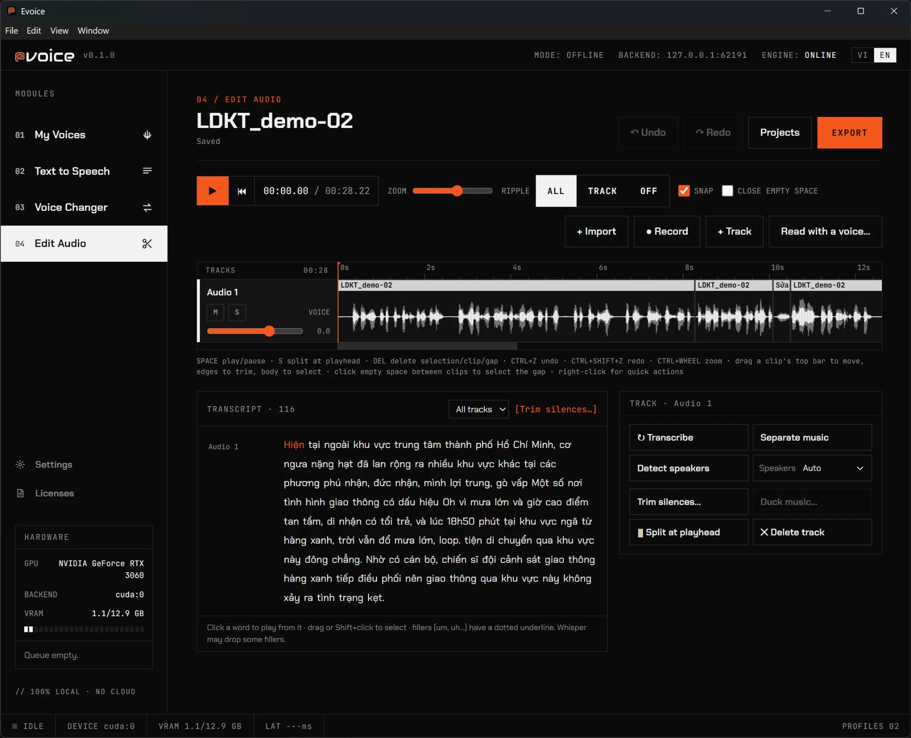
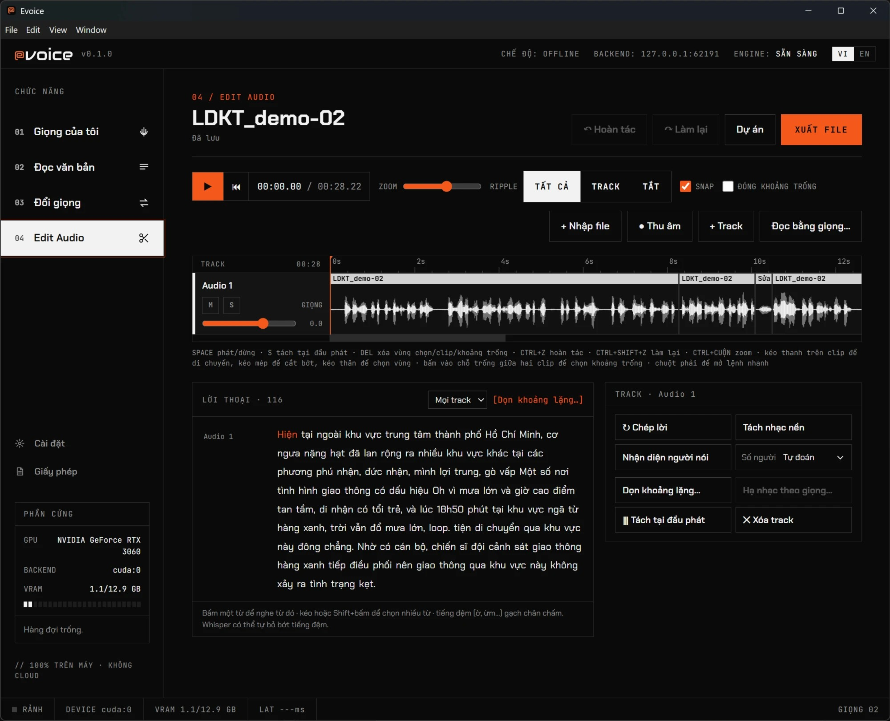

<p align="center">
  <picture>
    <source media="(prefers-color-scheme: dark)" srcset="docs/brand/evoice-logo-white.svg">
    
  </picture>
</p>

<p align="center">
  <b>English</b> · <a href="#tiếng-việt">Tiếng Việt</a>
</p>

<a id="english"></a>

# Evoice — offline AI voice studio

Evoice (project/code name: EasyVoice) is a desktop app that runs voice AI **100% on your own computer**: clone a voice from a short clip, read any text in that voice, change your voice live while you talk, and edit recordings by editing the text. No account, no cloud, telemetry off. After the one-time model download it works offline. Vietnamese comes first, English is supported.

<p align="center">
  
</p>

## Download

Get the latest installer from the **[Releases page](https://github.com/XavierChuu/EasyVoice/releases/latest)**.

| Your computer | File |
|---|---|
| Windows 10 / 11 (64-bit) | `Evoice-Setup-0.1.0.exe` |
| macOS, Apple Silicon | `Evoice-0.1.0-arm64.dmg` |
| macOS, Intel | `Evoice-0.1.0.dmg` |

- **Windows:** an NVIDIA GPU (CUDA) with an up-to-date driver is strongly recommended. Without a GPU the app runs on CPU, which is very slow and has no real-time voice changing.
- **macOS:** 13 or newer. Apple Silicon is recommended; Intel Macs work but are much slower.
- **First launch** needs internet and several GB of disk space: Evoice installs its AI runtime, then downloads the models once.
- The Windows installer is not code-signed yet. If SmartScreen warns you, click **More info → Run anyway**.

## Features

- **My Voices** — Quick voice from a 5–12 s clip (no training), or a High-quality voice trained on 10–30 min of audio (background, pausable). Emotion variants, tags, and sharing as a single `.evoice` file with a license you choose. Imports are security-scanned.
- **Text to Speech** — F5-TTS. Sentence-by-sentence rendering and re-rendering, speed and pauses, text normalization, personal dictionary, a different voice per selected passage. *Direct* mode (fast) or *Via RVC* (closer, more stable voice).
- **Voice Changer** — RVC v2. File mode (optionally separates and remixes the music) and live real-time mode for Discord / OBS / Zoom through a virtual audio device, with hotkeys 1–9 to switch voices and direct recording to WAV.
- **Edit Audio** — multitrack editor: transcribe and edit like text (delete or rewrite words in the same voice, remove fillers), trim silences with a review step, duck music under speech, detect speakers, separate vocals from music, filters, and export with loudness presets and `.srt` subtitles.
- English and Tiếng Việt interface, built-in auto-update, bundled FFmpeg.

## Important notes

- **Model licenses.** Some Text-to-Speech models (F5-TTS English/Chinese and the Vietnamese ViVoice model) are licensed **non-commercial** by their authors, so audio generated with them is for personal, non-commercial use. The other models are MIT-licensed. The full list is in the app under **Licenses** and in [`models.manifest.json`](models.manifest.json).
- **Consent.** Only clone your own voice or a voice you have permission to use.
- **License of the source code:** Evoice's own code is released under the **GNU GPL v3 or later** (see [License](#license)). This does not change the licenses of the AI models above.

## Build from source

Requirements: Node.js (current LTS), Python 3.11, FFmpeg in `PATH` (for development).

```bash
# 1. Python engine — see engine/README.md for the full setup (venv, requirements, models)
# 2. Desktop app
cd apps/desktop
npm install
npm run electron:dev      # starts Vite + Electron; uses the engine if installed, otherwise a mock engine
```

Build an installer: `npm run dist` (output in `apps/desktop/release`). FFmpeg for packaging: `npm run fetch:ffmpeg` (Windows) or `scripts/build-ffmpeg-mac.sh` (macOS).

## Repository layout

```
apps/desktop/        Electron + React app
engine/              Python sidecar (FastAPI); third_party/ holds vendored code
packages/api-types/  TypeScript types generated from OpenAPI
spikes/              Phase 0 benchmark scripts (not shipped)
docs/                Spec, UI mockup, open questions, ADR, brand, marketing
scripts/             Build and packaging helpers
models.manifest.json Official model list (url, sha256, size, license)
```

Models and user data are never stored in this repository.

<a id="license"></a>

## License

Copyright © 2026 Xavier Chu. Evoice's source code is licensed under the [GNU General Public License v3.0 or later](LICENSE) (`GPL-3.0-or-later`). Third-party code and bundled components (RVC, FFmpeg LGPL, libraries) keep their own licenses, and AI models are licensed separately by their authors: see [`NOTICE`](NOTICE).

## Author

Made by **Xavier Chu** — [xcmotion.net](https://xcmotion.net) — [xc.232192@gmail.com](mailto:xc.232192@gmail.com)

---

<a id="tiếng-việt"></a>

<p align="center">
  <a href="#english">English</a> · <b>Tiếng Việt</b>
</p>

# Evoice — studio giọng nói AI chạy offline

Evoice (tên dự án / mã nguồn: EasyVoice) là ứng dụng desktop chạy Voice AI **100% trên máy của bạn**: nhân bản giọng từ một đoạn ngắn, đọc văn bản bằng giọng đó, đổi giọng trực tiếp khi đang nói và chỉnh sửa bản ghi âm bằng cách sửa văn bản. Không cần tài khoản, không cloud, tắt telemetry. Sau lần tải model đầu tiên, app dùng được offline. Ưu tiên tiếng Việt, có hỗ trợ tiếng Anh.

<p align="center">
  
</p>

## Tải về

Tải bộ cài mới nhất ở **[trang Releases](https://github.com/XavierChuu/EasyVoice/releases/latest)**.

| Máy của bạn | File |
|---|---|
| Windows 10 / 11 (64-bit) | `Evoice-Setup-0.1.0.exe` |
| macOS, chip Apple Silicon | `Evoice-0.1.0-arm64.dmg` |
| macOS, chip Intel | `Evoice-0.1.0.dmg` |

- **Windows:** nên có card NVIDIA (CUDA) và driver mới. Không có GPU thì app chạy bằng CPU, rất chậm và không có đổi giọng thời gian thực.
- **macOS:** 13 trở lên. Khuyên dùng Apple Silicon; Mac Intel vẫn chạy nhưng chậm hơn nhiều.
- **Lần chạy đầu** cần Internet và vài GB ổ trống: Evoice cài môi trường AI rồi tải các model một lần.
- Bộ cài Windows chưa được ký số. Nếu SmartScreen cảnh báo, bấm **More info → Run anyway**.

## Tính năng

- **Giọng của tôi** — giọng Nhanh từ đoạn 5–12 giây (không cần train), hoặc giọng Chất lượng cao huấn luyện từ 10–30 phút audio (chạy nền, tạm dừng được). Biến thể cảm xúc, thẻ tìm kiếm, chia sẻ thành một file `.evoice` với giấy phép do bạn chọn. File nhập vào được quét an toàn.
- **Đọc văn bản** — F5-TTS. Render và đọc lại từng câu, chỉnh tốc độ và độ nghỉ, chuẩn hóa văn bản, từ điển riêng, gán giọng khác nhau cho từng đoạn được chọn. Chế độ *Trực tiếp* (nhanh) hoặc *Qua RVC* (giọng giống và ổn định hơn).
- **Đổi giọng** — RVC v2. Chế độ file (có thể tách rồi trộn lại nhạc nền) và chế độ trực tiếp thời gian thực cho Discord / OBS / Zoom qua thiết bị âm thanh ảo, phím tắt 1–9 để đổi giọng, ghi thẳng ra WAV.
- **Edit Audio** — trình sửa nhiều track: chép lời và sửa như văn bản (xóa hoặc viết lại từ bằng chính giọng đó, bỏ tiếng đệm), dọn khoảng lặng có bước xem lại, hạ nhạc nền theo giọng nói, nhận diện người nói, tách giọng khỏi nhạc, bộ lọc, xuất với mức âm lượng chuẩn và phụ đề `.srt`.
- Giao diện Tiếng Việt và English, tự cập nhật trong app, đóng kèm FFmpeg.

## Lưu ý quan trọng

- **Giấy phép model.** Một số model Đọc văn bản (F5-TTS Anh/Trung và ViVoice tiếng Việt) được tác giả cấp phép **phi thương mại**, nên audio tạo bằng chúng chỉ dùng cá nhân, không thương mại. Các model còn lại dùng giấy phép MIT. Danh sách đầy đủ ở mục **Giấy phép** trong app và trong [`models.manifest.json`](models.manifest.json).
- **Sự đồng ý.** Chỉ nhân bản giọng của chính bạn hoặc giọng bạn được phép dùng.
- **Giấy phép mã nguồn:** mã của Evoice được phát hành theo **GNU GPL v3 trở lên** (xem [Giấy phép](#giấy-phép)). Điều này không thay đổi giấy phép của các model AI nêu trên.

## Build từ mã nguồn

Yêu cầu: Node.js (bản LTS mới), Python 3.11, FFmpeg trong `PATH` (khi phát triển).

```bash
# 1. Engine Python — xem engine/README.md để cài đủ (venv, requirements, model)
# 2. App desktop
cd apps/desktop
npm install
npm run electron:dev      # chạy Vite + Electron; dùng engine nếu đã cài, không thì chạy engine giả (mock)
```

Tạo bộ cài: `npm run dist` (kết quả ở `apps/desktop/release`). FFmpeg để đóng gói: `npm run fetch:ffmpeg` (Windows) hoặc `scripts/build-ffmpeg-mac.sh` (macOS).

## Cấu trúc thư mục

```
apps/desktop/        Electron + React
engine/              Python sidecar (FastAPI); third_party/ chứa code vendored
packages/api-types/  TypeScript types sinh từ OpenAPI
spikes/              Phase 0: script đo hiệu năng, không đưa vào app
docs/                Đặc tả, UI mẫu, câu hỏi mở, ADR, brand, marketing
scripts/             Build, đóng gói
models.manifest.json Danh sách model chính thức (url, sha256, size, license)
```

Model và dữ liệu người dùng không bao giờ nằm trong repo.

<a id="giấy-phép"></a>

## Giấy phép

Bản quyền © 2026 Xavier Chu. Mã nguồn Evoice được cấp phép theo [GNU General Public License v3.0 trở lên](LICENSE) (`GPL-3.0-or-later`). Mã của bên thứ ba và các thành phần đóng kèm (RVC, FFmpeg LGPL, thư viện) giữ giấy phép riêng, còn model AI do tác giả của chúng cấp phép riêng: xem [`NOTICE`](NOTICE).

## Tác giả

Phát triển bởi **Xavier Chu** — [xcmotion.net](https://xcmotion.net) — [xc.232192@gmail.com](mailto:xc.232192@gmail.com)
